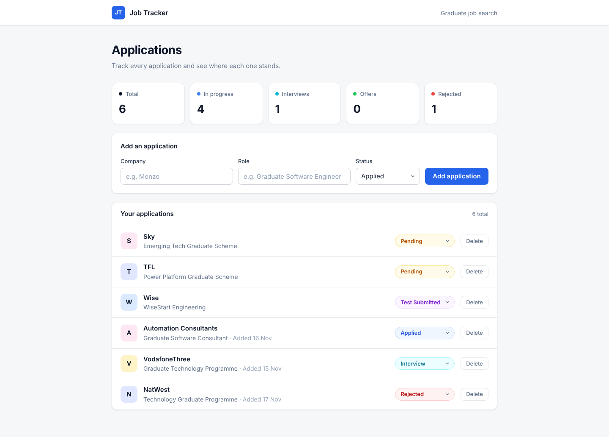

# Job Tracker

A web app for tracking graduate job applications: add each application, update its status as it moves through the process, and see at a glance how many are in progress, at interview, offered or rejected.



## Features

- Add an application (company, role, status)
- Change status from a dropdown on each application (Applied, Pending, Test Submitted, Interview, Offer, Rejected)
- Delete applications
- Summary counts for each stage
- Filter the list by status
- Data stored in a database through a Django REST API
- Responsive layout that works on phones

## Tech stack

**Frontend:** React (Vite), JavaScript, CSS
**Backend:** Python, Django, Django REST Framework, SQLite (PostgreSQL planned for deployment)
**Testing:** Django REST Framework `APITestCase`

## Project structure

```
job-tracker/
├── src/                  React frontend
│   ├── App.jsx           State, form, filter and summary counts
│   └── ApplicationCard.jsx
└── backend/              Django REST API
    ├── config/           Settings and URL routing
    └── applications/     Model, serializer, viewset, tests
```

## API

| Method | Endpoint | Description |
| --- | --- | --- |
| GET | `/api/applications/` | List all applications |
| POST | `/api/applications/` | Create an application |
| PATCH | `/api/applications/<id>/` | Update an application (e.g. its status) |
| DELETE | `/api/applications/<id>/` | Delete an application |

Invalid data (for example a missing company or an unknown status) returns `400 Bad Request` with the reason.

## Running locally

**Frontend**

```bash
npm install
npm run dev
```

Then open http://localhost:5173

**Backend**

```bash
cd backend
python3 -m venv venv
source venv/bin/activate
pip install -r requirements.txt
python manage.py migrate
python manage.py runserver
```

The API runs at http://127.0.0.1:8000/api/applications/

**Tests**

```bash
cd backend
python manage.py test
```

## Roadmap

- [x] React frontend with add, update, delete and filter
- [x] Django REST API with tests
- [x] Connect the React app to the API (data saved in the database)
- [ ] Deploy (frontend on Vercel, API and PostgreSQL database online)
